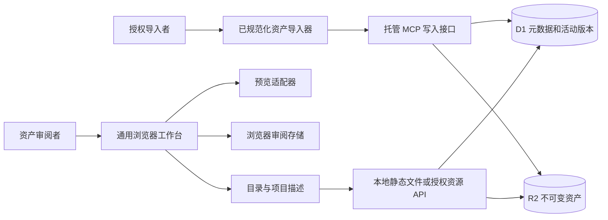
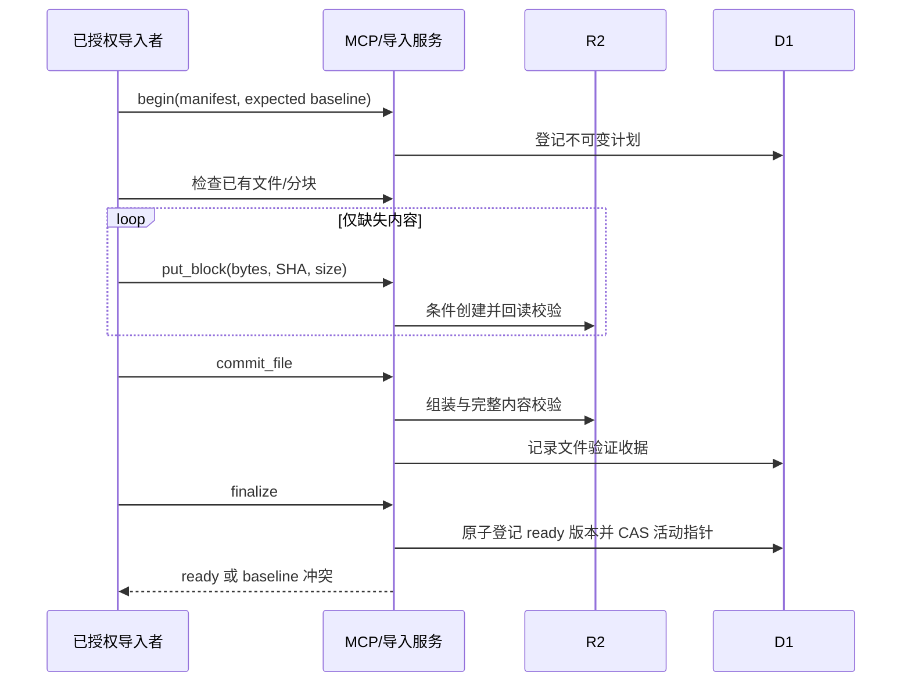

# 架构说明

## 1. 范围、目标与约束

AssetsPlatform 的目标是把不同资产来源放入同一审阅工作流，而非复制原游戏运行环境。核心质量属性是目录隔离、稳定身份、可解释失败、资源完整性、异步生命周期正确和可独立理解的接口。当前实现尚处于从特定托管站点向通用工具拆分的阶段，不能把目标架构等同于现有完成状态。

本仓库有两种边界：

- `apps/reviewer/`：无需账号的本地静态应用，含 UI、索引式适配器、GLB viewer、本地审阅和合成样例。
- `reference/hosted/`：现有托管实现的脱敏参考，含 Worker、HTTP/MCP、D1/R2 协调、规范前端和原生预览代码；私有生成数据及部分依赖有意不分发，不能独立构建。

## 2. 系统上下文

右侧托管写入与存储不属于独立前端。浏览器并不能因显示资源目录就获得上传权限；写入身份与读取身份必须分开。

## 3. 组件职责与依赖方向

| 层 | 代表模块 | 职责与禁止事项 |
|---|---|---|
| 页面/应用 | app.mjs、shell-controller.mjs | 状态、DOM、导航、详情；不应按游戏名决定布局 |
| 项目登记 | project-loader.mjs | 加载登记的目录描述；不是任意脚本插件市场 |
| 数据适配 | indexed-data.mjs、托管 entity-data.mjs | 将不同索引映射为物件/资源；不操作 DOM |
| URL 与生命周期 | resource-url.mjs | 资源根、路径策略、取消作用域；不是完整安全沙箱 |
| 预览 | viewer-adapter.mjs、viewer.mjs、托管 entity-viewer | 模型解析、渲染、资源释放；不改变审阅结论 |
| 审阅状态 | workbench.mjs、selection-state*.mjs | 状态校验、分页、本地保存；v2 身份校验与 v1 确认迁移 |
| 输出 | review-export.mjs、selection-manifest.mjs | 精简索引、审阅与选择；不包含模型备份 |
| 托管网关 | app/chatgpt-auth.ts、worker/index.ts | 依赖可信入口身份；不可替代独立认证实现 |
| 应用服务 | lib/asset-pilot-mcp.mjs、incremental-candidate/transport.mjs | 有界导入协议和恢复；不允许任意对象键写入 |
| 持久化 | incremental-candidate/storage.mjs、db/ | 不可变内容、校验回读、原子活动版本切换 |

托管规范前端由 `review-frontend/emit.mjs` 生成项目发布副本。`asset-source/` 当前混合手写渲染模块、生成 UI 和私有数据，尚不是清晰的可发布软件包。可运行本地前端是经过明确裁剪的发行入口，不是另一个游戏特化页面。

## 4. 主要数据流

### 4.1 浏览与审阅

1. 读取 `project-directory.json`，选择登记的项目描述。
2. 建立项目资源根和取消作用域，按 dataKind 选择数据适配器。
3. 读取资源目录、物件目录和渲染/材质配置，生成同一界面数据。
4. 按搜索/筛选/分页选择可见条目，按适配器能力请求预览。
5. 详情切换与目录切换取消旧任务；晚到结果不能覆盖新选择。
6. 审阅状态与备注写入本地存储，选择与渲染偏好按配置键保存。
7. 导出 JSON 只输出索引和审阅记录；默认导入按当前已知 ID 合并。v2 校验项目/数据集；旧版经确认合并迁移。独立前端另有显式精确恢复入口，仅限单键本地状态、同身份 v2 完整备份；严格校验和替换确认后先单次持久化，再更新内存。文件读取按操作代次及身份隔离，旧请求不覆盖新操作；不提供自动检查点或跨标签页事务。

### 4.2 托管增量导入

协议先保证所有文件可读和一致，再使新版本可见。丢失响应通过读回协调，不能仅因请求发出就声称成功。既有不可变版本保持可读；并发旧基线不得覆盖新活动版本。

## 5. 数据模型

- Project：目录来源的稳定身份。
- Dataset：某项目下的一组受版本控制的资源。
- Version：由清单定义的不可变内容版本，不是显示名称。
- Object/Entity：审阅单位，稳定 ID 对应完整物件或明确标注的局部对象。
- Resource：模型、图片或元数据文件，路径、字节数和摘要用于定位与验证。
- Review：个人状态、备注和更新时间；不能与模型供应状态混为一谈。

D1 主要表：`ingest_plans` 保存规范化计划及基线，`ingest_files` 保存内容校验收据，`ingest_versions` 保存就绪版本，`ingest_active` 保存项目/数据集活动指针及 revision。旧固定批次还使用 `entity_asset_versions` 和 `entity_asset_batch_chunks`。表结构不包含实际部署的种子状态。

R2 内容键按项目/数据集/摘要或版本隔离。字节一致性校验不证明资产拥有再分发许可，也不证明 Shader 与原引擎相同。

## 6. 渲染架构

通用样式参数定义在 `shared/common-render-profiles.mjs`。独立索引式 viewer 和托管原生 Three 适配器可消费相同意图，但具体支持的几何、骨骼、动画、材质与对比能力不同。

当前内置六种独立前端风格：源材质、白模、三阶卡通、自然柔光、双阶冷影、双阶暖调。历史风格 ID 是兼容键，不代表携带对应游戏美术或复现原 Shader。原生适配器额外提供无光照/线框检查。

托管原生路径有共享 renderer、预览队列、缓存与预算控制；不得据此推定独立 viewer 拥有相同总预算。本轮为独立 parser 加入几何、图像和下载预算，并拒绝未知必需扩展；这不是浏览器总堆内存保证。

## 7. 信任边界

- 资产包提供数据，不提供可任意执行的 JavaScript viewer。
- 本地目录被视为使用者信任的数据源；浏览器解析器仍须逐步补齐恶意输入防护。
- 托管身份来自可信网关，应用读取的身份头本身不是密码学证明。
- 固定静态资源在 Worker 早期路径读取，必须由宿主入口保护；仅保护 API 不足以保护静态资源。
- 写入要求已配置的 owner 映射，不采用首次访问者自动成为 owner。
- 公共仓库仅含合成资产和脱敏参考，不能携带实际账号、访问名单或私有存储计划。

## 8. 当前架构债务与演进顺序

1. 已修复跨目录导入身份和 GLB 元数据隐私校验，并新增反例回归。
2. 已建立描述、目录、补充资源 ID 和存储键校验；扩展契约时必须同步测试。
3. 把固定项目/批次策略注入服务，移出通用算法。
4. 提取预览器、规范化模型与校验代码为独立模块，清理混合生成目录。
5. 建立不依赖私人数据的完整构建和测试 fixture，补齐可部署认证/storage provider。
6. 完成真实 GPU、多账号负向权限、并发恢复和端到端性能验证，再承诺通用自托管发行版。

本次已完成针对性修复和复审，保留明确模块边界；未以大规模重写冒充完整通用后台。详细问题、重现与优先级见 CODE-REVIEW.md。
